# MakanWhat?

A personal fork of [BudgetAPP](https://github.com/szem00/BudgetAPP), the voice expense tracker (this repo is MakanWhatApp). It adds a **meal finder** that answers *"what can I eat nearby with what's left?"*, and a look of its own. It installs beside the main app as `com.budgetapp.voiceexpense.personal`, with its own data.

<p>
  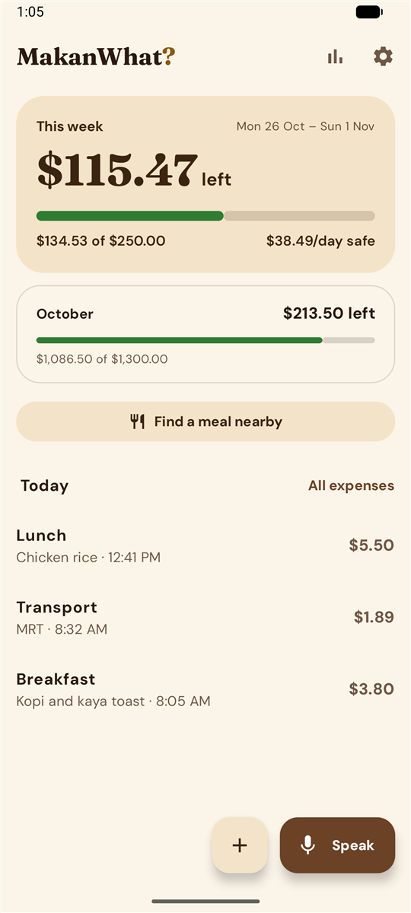
  &nbsp;
  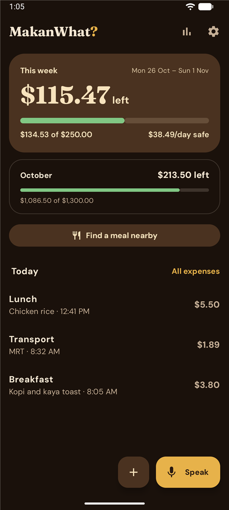
</p>

## The Kopi coin look

The app is called **MakanWhat?**, Singlish for *"eat what?"*. Its icon is a gold coin stamped with MW in slab serifs, where the W is the M turned upside down, on espresso brown.

- **Fixed brand colours** replace the main app's wallpaper colours: espresso and coffee-milk browns on warm paper by day, cream and coin gold on dark roast by night. The widget uses them too.
- **Fraunces**, a serif, sets the name, screen titles and the big amount left this week. **DM Sans** sets everything else. Both come from Google Fonts through Play services, so they add nothing to the APK. Until they've downloaded, or on a phone without Play services, the phone's own font shows instead.
- **Budget bars** are green while you're on track, amber once 85% is gone, and red when you're over.

The colours are in `ui/theme/Color.kt`, the fonts in `ui/theme/Type.kt`, and the icon in `res/drawable/ic_launcher_foreground.xml`.

## Meal finder

Tap **Find a meal nearby** on the home screen. The meal finder shows:

- **Your budget per meal:** what's left of this week's budget, divided by the breakfasts, lunches and dinners still to come. Meals already logged today don't count.
- **Your places within 2 km:** meals you've logged nearby whose last price fits that budget. Each new expense remembers where it was logged, once you allow location.
- **Nearby on Google Maps:** restaurants and food courts within 2 km from the Places API (New), nearest first. Places priced over a meal's budget are left out. Places with no price data, which includes many hawker stalls, stay in.

Google returns at most 20 places per search. In a city centre the nearest 20 restaurants can all be in one block, so the meal finder runs a second search for food courts alone, which Google also uses for hawker stalls. That brings in the hawker centres a few minutes' walk away.

Tap any place for walking directions in Google Maps.

Unlike the main app, this fork has internet and location permissions, and its database is at version 2, which adds a location to each expense.

### Setting up the Places API key

Without a key, the meal finder still shows your own places.

1. In the [Google Cloud console](https://console.cloud.google.com/), create a project, attach a billing account and enable **Places API (New)**.
2. Create an API key, then restrict it:
   - **Application restrictions:** Android apps, package `com.budgetapp.voiceexpense.personal`, plus the SHA-1 of the key that signs your builds. For the debug key on this PC that's `CD:FD:D9:E5:1C:D7:B8:68:A3:D8:59:3E:92:04:9B:B8:C2:4D:9A:3E`.
   - **API restrictions:** Places API (New) only.
3. Keep it free. Each request asks for prices, which makes it an Enterprise call, and each meal finder search makes two requests. Solo use stays inside the free monthly allowance. Under **Quotas**, cap Nearby Search at about 30 requests a day, which allows 15 searches. Also set a US$1 budget alert under **Billing**.
4. Add the key to `local.properties` in the project folder, which Git ignores, then rebuild:

   ```properties
   PLACES_API_KEY=your-key-here
   ```

### Keeping up with the main app

The main repo is the `upstream` remote, set to fetch only so nothing here can be pushed to it by mistake. To bring in its latest changes:

```powershell
git fetch upstream
git merge upstream/main
```

The rest of this README is the main app's, so its screenshots show the main app's wallpaper colours rather than the Kopi coin look.

---

# Voice Expense Tracker

**Log what you spend by saying it.** Tap the mic on your home screen, say *"lunch chicken rice 5.50"*, and it's saved as a $5.50 lunch, without ever opening the app. Your week's budget updates as you go.

A native Android app in Kotlin and Jetpack Compose. Your expenses stay on your phone: there's no account, no server, and the app doesn't have internet permission.

<p align="center">
  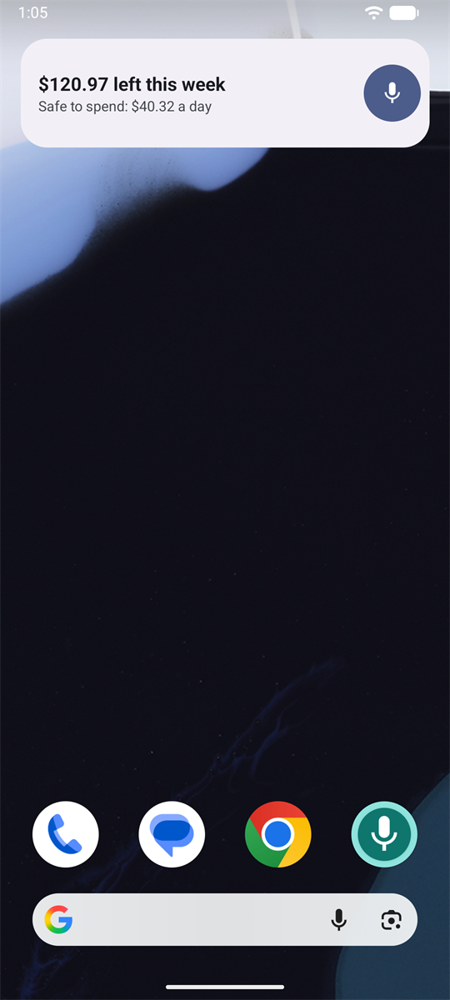
  &nbsp;
  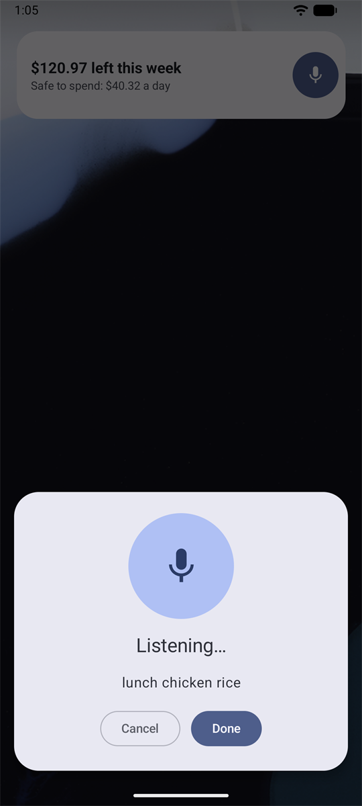
  &nbsp;
  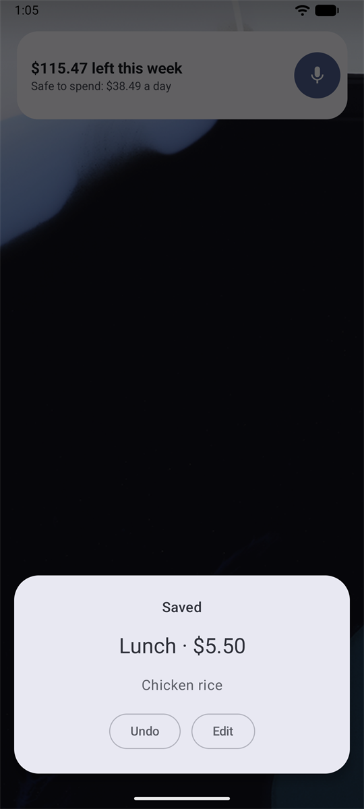
</p>
<p align="center"><sub>Tap the widget's mic, say the expense, and it's saved. The card offers Undo and Edit for a few seconds, then closes itself.</sub></p>

## Features

- **Voice logging from the home screen.** The widget shows what's left of this week's budget, with a mic button. What you say is saved straight away, with no confirm step.
- **Listens through pauses.** It keeps listening until it hears a price, so *"lunch… chicken rice… five fifty"* still works. Tap **Done** to stop early.
- **In-app logging too.** **Speak** shows what it heard on a confirm card before saving. **+** opens a form for typing.
- **Weekly and monthly budgets.** See what you've spent, what's left and how much is safe to spend each day for the rest of the week.
- **Trends.** Daily spending this week, 12 weeks against your budget, spending by category and the average cost of each meal.
- **CSV export** of every expense, ready for Excel or Power BI.
- **Light, Dark or System theme**, chosen in settings, and the widget follows it. On Android 12 and newer the colours come from your wallpaper.

## A tour

### Logging by voice in the app

<p align="center">
  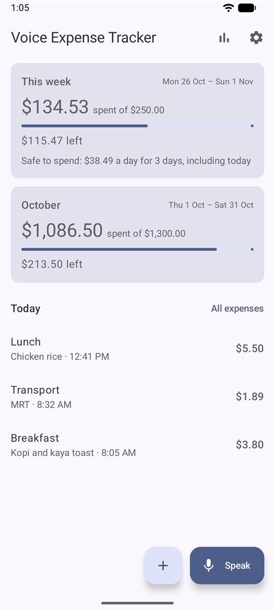
  &nbsp;
  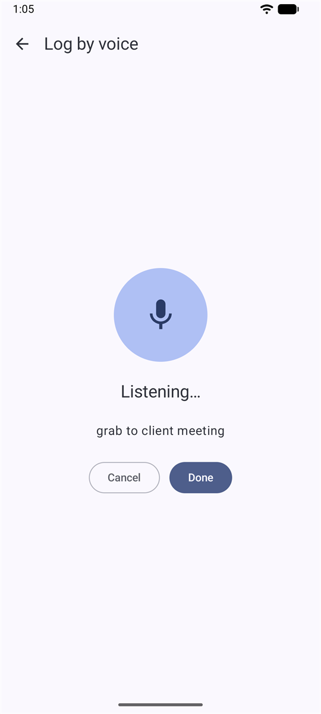
  &nbsp;
  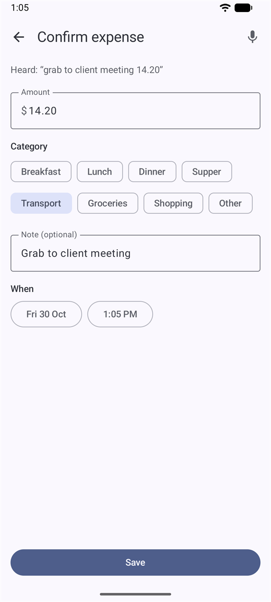
</p>
<p align="center"><sub>"Grab" picks Transport and the rest becomes the note. Fix anything the parser missed, then tap Save.</sub></p>

### Trends and history

<p align="center">
  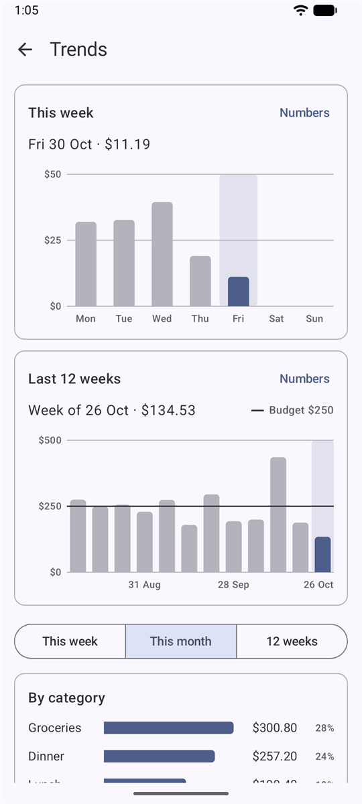
  &nbsp;
  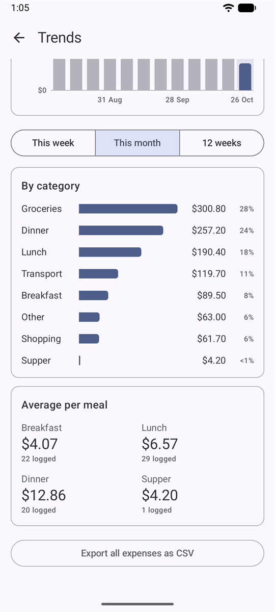
  &nbsp;
  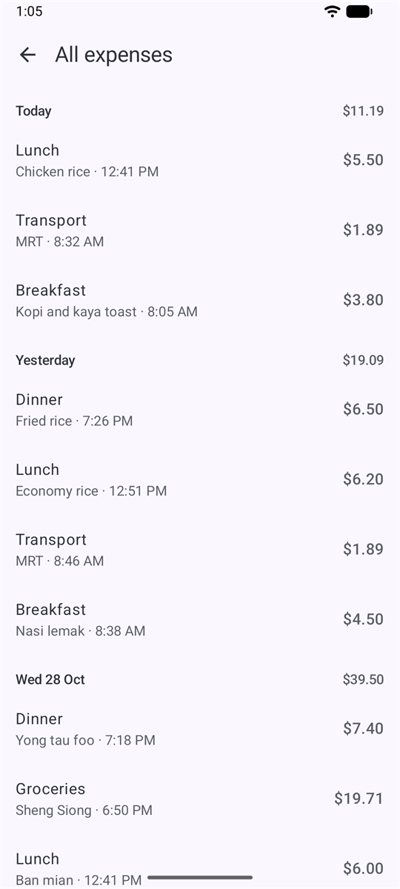
</p>
<p align="center"><sub>Tap any bar for its exact amount, or tap Numbers for a table. The period buttons choose what the category and meal sections cover.</sub></p>

### Dark theme and settings

<p align="center">
  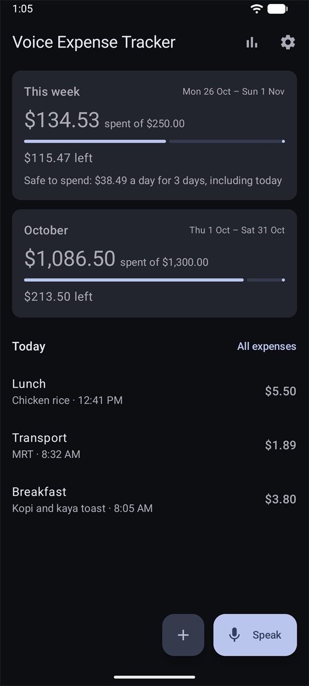
  &nbsp;
  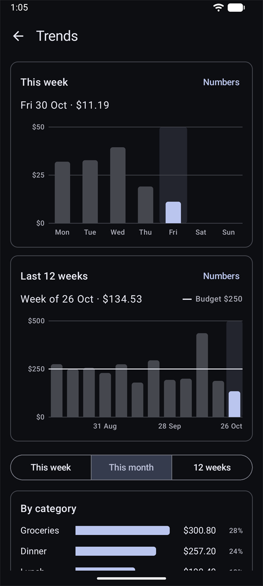
  &nbsp;
  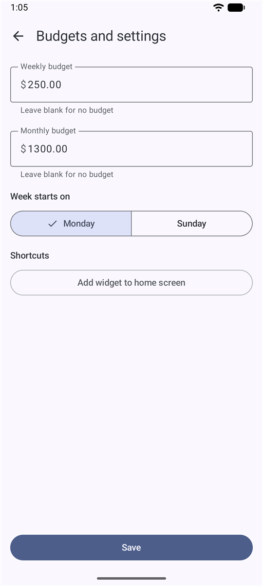
</p>

<sub>All screenshots use made-up demo data.</sub>

## What you can say

Say what you bought and what it cost, in any order. The parser runs on the phone and uses simple rules, not AI.

| You say | It saves |
| --- | --- |
| "lunch chicken rice 5.50" | Lunch · $5.50 · *Chicken rice* |
| "grab to client meeting 14.20" | Transport · $14.20 · *Grab to client meeting* |
| "NTUC groceries 48 dollars" | Groceries · $48.00 · *NTUC* |
| "coffee five fifty" at 9am | Breakfast · $5.50 · *Coffee* |
| "kopi" | Nothing, since there's no price. You can try again or type it instead. |

**Prices** can be said as *5.50*, *$5.50*, *five fifty*, *five dollars fifty*, *five point five* or *fifty cents*. If you mention more than one number, as in *"2 kopi 3.20"*, the price is the one that sounds most like money.

**The category** comes from the first of these that applies:

1. A category name: *breakfast, lunch, dinner, supper, transport, groceries, shopping, other*.
2. A word that hints at one:
   - **Transport:** *bus, MRT, train, taxi, Grab, Gojek, TADA, EZ-Link, fare, petrol, parking, ERP*
   - **Groceries:** *NTUC, FairPrice, Cold Storage, Sheng Siong, Giant, supermarket*
   - **Shopping:** *Shopee, Lazada, Amazon, Taobao, Uniqlo, clothes, shoes*

   *Grab Food* counts as a meal, not transport.
3. The time of day:

   | Time | Category |
   | --- | --- |
   | 3am to 11am | Breakfast |
   | 11am to 3pm | Lunch |
   | 3pm to 5pm | Other |
   | 5pm to 9pm | Dinner |
   | 9pm to 3am | Supper |

Whatever's left becomes the note. The phone's own speech service turns your voice into text. On most phones that's Google's, which may need internet if your phone has no offline language pack.

## Exporting to CSV

At the bottom of **Trends**, tap **Export all expenses as CSV** and choose where to save the file. It lists every expense from oldest to newest, with these columns:

`id, date, time, amount, currency, category, note, source, raw_transcript`

`source` says whether you typed the expense or spoke it, and `raw_transcript` keeps exactly what was heard. The file is UTF-8 with a byte-order mark, so Excel opens it with the right characters.

## Building and installing

You need:

- **Android Studio** 2026.2 or newer. It comes with the JDK and Android SDK.
- **An Android phone** running Android 8.0 or newer, with USB debugging turned on.

Open the project in Android Studio and press **Run**, or build from the command line. On Windows:

```powershell
$env:JAVA_HOME = 'C:\Program Files\Android\Android Studio\jbr'
.\gradlew.bat assembleDebug
adb install -r app\build\outputs\apk\debug\app-debug.apk
```

To add the widget, long-press your home screen and pick **Widgets**, or tap **Add widget to home screen** in the app's settings.

> [!WARNING]
> **Don't lose your expenses when you update.** `adb install -r` replaces the app and keeps your data. Builds are signed with the debug key in `%USERPROFILE%\.android\debug.keystore`, which isn't part of this repository, so back it up. A build signed with a different key installs only after you uninstall the app, and uninstalling deletes every expense. Export a CSV first.

## Tests

```powershell
.\gradlew.bat test
```

This runs 70 unit tests covering the voice parser, money handling, budget periods, trends, CSV export and the theme choice.

```powershell
$env:ANDROID_SERIAL = 'emulator-5554'
.\gradlew.bat connectedDebugAndroidTest
```

This runs 60 on-device tests of every screen, the theme setting, the widget's quick capture and the database. They use an in-memory database and a fake speech recognizer, since an emulator can't hear you.

> [!CAUTION]
> `connectedDebugAndroidTest` uninstalls the app from every connected device when it finishes, which deletes its expenses. Run it on an emulator, and set `ANDROID_SERIAL` so it leaves a plugged-in phone alone.

<details>
<summary>Updating the README screenshots</summary>

`ReadmeScreenshots` builds 12 weeks of demo data, then captures each screen on an emulator. It's skipped unless you pass `-e screenshots true`.

1. Install both packages on the emulator.

   ```powershell
   .\gradlew.bat assembleDebug assembleDebugAndroidTest
   adb -s emulator-5554 install -r app\build\outputs\apk\debug\app-debug.apk
   adb -s emulator-5554 install -r app\build\outputs\apk\androidTest\debug\app-debug-androidTest.apk
   ```

2. In the app, tap **Add widget to home screen**. The test assumes the launcher puts the widget on its second page, as the Pixel launcher does when the first page is full.
3. Take the screenshots and copy them off the emulator.

   ```powershell
   adb -s emulator-5554 shell am instrument -w -e screenshots true -e class com.budgetapp.voiceexpense.ReadmeScreenshots com.budgetapp.voiceexpense.test/androidx.test.runner.AndroidJUnitRunner
   adb -s emulator-5554 pull /data/local/tmp/readme-screenshots/. docs/images
   ```

The images in `docs/images` are resized to 540 pixels wide.

</details>

## How it's built

- **Kotlin and Jetpack Compose** with Material 3. Navigation Compose moves between screens, and a small `AppContainer` passes dependencies around without a DI framework.
- **Room** stores the data, with schemas exported to `app/schemas`. The database holds real spending, so any schema change needs a migration rather than a wipe.
- **DataStore** keeps the theme choice outside the database, so adding it needed no migration. On Android 12 and newer the app passes the choice to the system, which applies it to the splash screen and status bar too.
- **Money is stored in whole cents**, so totals never pick up rounding errors.
- **Android's `SpeechRecognizer`** sits behind a small `VoiceRecognizer` interface, which tests replace with a fake.
- **The widget** uses `RemoteViews`. Its mic opens `QuickCaptureActivity`, a see-through overlay with its own task, so logging an expense doesn't bring up the rest of the app.
- **The charts** are drawn on a Compose `Canvas`, with no chart library.

```
app/src/main/java/com/budgetapp/voiceexpense/
├── data/      Room entities, DAOs and the database
├── domain/    Plain Kotlin: voice parser, money, periods, budgets, trends, CSV
├── voice/     Wrapper around Android's speech recognizer
├── quick/     The widget's quick-capture overlay
├── widget/    Home screen widget
└── ui/        Compose screens: home, entry, voice, history, trends, settings
```

## Ideas for later

None of these are started:

- Cloud backup and sync
- An AI fallback for phrases the rules can't read
- Recurring expenses
- A reminder if no lunch is logged by 3pm
